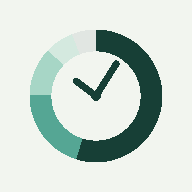

# OpenCodex Mobile

[English](README.md) | [한국어](README.ko.md)

[OpenCodex](https://github.com/lidge-jun/opencodex)를 개인 휴대폰에서 관리하는 웹앱과 Scriptable 위젯입니다.



세이지 녹색 배경과 시계 도넛 아이콘은 위젯의 단계별 녹색 배색을 사용합니다.

OpenCodex 또는 OpenAI의 공식 앱이 아닌 독립적인 연동 도구입니다. 사용자마다 본인의 Mac에서 실행 중인 OpenCodex에 연결합니다. 공용 중계 서버는 포함하지 않습니다.

## 처음 설치하기

[Quick Start — 컴퓨터 준비부터 휴대폰 연결·알림·위젯까지](docs/QUICKSTART.ko.md)

Mac·Windows와 iPhone·Android의 현재 지원 범위 및 단계별 안내를 확인하세요. Mac·Windows 자동 설치를 지원합니다. Windows 실기기 검증, QR 연결과 Android 위젯 실기기 검증은 남아 있습니다.

## Android 위젯 (QA)

[설치·빌드·QA 안내](android/README.md): QA APK 설치 후 웹앱에서 **Android 위젯 연결**을 누르고 서버 연결·홈 화면 추가를 확인합니다. 주소와 키는 자동 전달하며 기존 Scriptable 디자인을 재현합니다. 실기기 검증과 정식 배포는 남아 있습니다.

## 기능

- 계정 풀 사용량·리셋 시각 확인, 계정 선택, 일시 중지·재개, 우선순위·Rotation 설정
- 계정별 banked reset 잔여 개수 조회와 명시적 확인 후 1개 사용
- iPhone 홈 화면 웹앱 및 Web Push 알림
- Scriptable 위젯: 5시간 전체 잔량, 다음 회복 3개, 주간 평균 잔량과 다음 주간 회복 2개
- 5분 이후 위젯 갱신 요청: 실제 갱신 시점은 iOS가 결정
- 수동 새로고침: Scriptable을 열어 최신 조회 후 미리보기 표시
- 서버 재시작 후에도 유지되는 로그인과 직접 로그아웃
- 조회 결과 정리·예약 실행에 추가 LLM 호출 없음

위젯의 합산 수치는 각 계정의 잔여율을 동일 가중치로 평균한 근사치입니다. 플랜별 절대 토큰 용량 차이를 반영하지 않습니다. 캐시 값과 오래된 기록은 현재 사용 가능 여부를 보장하지 않습니다.

## 필요 환경

- Node.js 20 이상
- 같은 Mac에 설치되어 실행 중인 OpenCodex와 등록된 계정
- 웹앱에 연결되는 고정 HTTPS 주소
- 위젯을 사용하려면 iPhone의 Scriptable 앱

이 웹앱은 공급자 계정을 새로 등록하지 않습니다.

## macOS 자동 설치

```sh
npm ci
npm run setup -- --url=https://YOUR-ASSIGNED-DOMAIN.ngrok-free.dev
```

설치 도우미는 Node·OpenCodex 상태를 확인하고 사용자 Application Support 폴더에 앱을 설치합니다. 의존성과 ngrok이 없으면 설치하고, 필요한 경우 터미널에서 토큰을 숨겨 입력받습니다. 웹앱·터널 LaunchAgent를 등록합니다. 기존 실행용 폴더의 인증 정보·알림 구독·로그인 세션은 보존합니다. ngrok 가입과 고정 주소 발급은 먼저 완료해야 합니다.

```sh
npm run update          # 현재 체크아웃을 설치·재시작, git pull은 하지 않음
npm run service:status # 웹앱·터널 서비스 상태 확인
npm run service:stop   # 서비스 중지, 데이터와 등록 파일 보존
npm run setup          # 저장된 설정으로 재활성화·설치 이어가기
```

처음 토큰을 입력할 때는 Mac의 대화형 터미널에서 실행하세요. 업데이트는 저장된 고정 주소를 재사용합니다. 설치 시 실행 중인 ngrok에서 주소를 찾을 수도 있으며, 없으면 `--url`을 지정해야 합니다. 관리자 설치는 필요하지 않지만 macOS 권한 알림은 직접 승인해야 할 수 있습니다. QR 연결과 완전 제거 명령은 아직 없습니다.

## Windows 자동 설치

Windows 10/11 x64의 PowerShell에서도 동일하게 `npm ci`와 `npm run setup -- --url=https://YOUR-ASSIGNED-DOMAIN.ngrok-free.dev`를 실행합니다. Node.js 20 이상, Git, npm으로 전역 설치한 OpenCodex(`@bitkyc08/opencodex`)가 필요합니다. OpenCodex는 먼저 실행하고 계정을 등록하세요. WSL 설치가 아닌 Windows 네이티브 설치를 사용합니다.

실행용 위치는 `%LOCALAPPDATA%\OpenCodexMobile`입니다. 작업 스케줄러에 현재 사용자 로그인 시 실행하는 작업을 등록하고 즉시 시작합니다. 웹앱·ngrok이 종료되면 10초 후 다시 실행하며, 감시 프로세스의 실패는 작업 스케줄러가 1분 간격으로 재시도합니다. 로그아웃·잠자기 중에는 접속할 수 없습니다. OpenCodex 자체의 자동 시작은 이 설치 도구에서 관리하지 않습니다.

`npm run service:status`, `npm run service:stop`, `npm run update`를 동일하게 사용합니다. 중지는 자동 시작도 비활성화하며 `npm run setup`으로 다시 활성화합니다. Windows 설치 코드와 프로세스 복구 테스트는 추가했지만 Windows에서 실제 설치·재로그인은 아직 검증하지 않았습니다.

## 실행

```sh
npm ci
export PUBLIC_HTTPS=1
export VAPID_SUBJECT=https://your-public-app-host
npm start
```

기본 주소는 `127.0.0.1:10300`입니다. 외부 터널에는 이 웹앱만 연결하고 OpenCodex 원본 관리 포트를 공개하지 마세요. 프록시는 공개 주소의 Host 헤더를 유지해야 합니다.

Mac의 `.data/pairing-code`를 확인해 로그인합니다. 연결 코드와 세션은 서버 재시작 후에도 유지됩니다. 서버 세션에는 만료 기간이 없으며 로그아웃으로 해제합니다. 쿠키는 접속할 때마다 400일로 연장하지만, 브라우저 정책·데이터 삭제·앱 재설치로 재로그인이 필요할 수 있습니다.

설정 변수: `PORT`, `HOST`, `PUBLIC_HTTPS`, `VAPID_SUBJECT`, `OPENCODEX_CLI`. `.env.example`은 참고용이며 `.env`를 자동으로 읽지는 않습니다. OpenCodex 설정은 현재 `~/.opencodex`를 사용합니다. 최신 사용량은 인증된 로컬 OpenCodex API로 조회합니다.

## iPhone 설치와 알림

1. Safari에서 HTTPS 주소를 열고 서버 연결 코드로 로그인합니다.
2. 공유 → 홈 화면에 추가를 선택합니다.
3. 홈 화면 앱을 열어 **이 기기 알림 등록 → 테스트**를 실행합니다.
4. 원하는 경우 **예약 사용량 알림 켜기**를 선택합니다.

한국 시간 기준 일정:

| 구분 | 시간 | 간격 |
|---|---|---|
| 평일 오전 | 09:00–10:30 | 30분 |
| 평일 저녁 | 20:00–23:30 | 30분 |
| 주말 | 12:00–20:00 | 1시간 |

알림 기본값은 꺼짐입니다. Mac과 서버가 실행 중이어야 합니다. 푸시 서비스의 접수 성공은 휴대폰 표시를 보장하지 않습니다. 알림 권한·집중 모드·알림 요약을 확인하세요. 웹앱을 삭제하고 다시 추가했다면 기기 알림도 다시 등록해야 합니다. 인증된 `/api/push/keep-device` 경로로 지정한 구독만 유지하고 이전 구독을 정리할 수 있습니다.

## Scriptable 위젯

웹앱에서 **위젯 코드 복사**를 누르고 Scriptable의 새 스크립트에 붙여넣은 후 한 번 실행합니다. 고정 HTTPS 주소와 웹앱에서 표시한 위젯 키를 입력하세요. 홈 화면에 중간 크기 Scriptable 위젯을 추가하고 해당 스크립트를 선택합니다.

위젯은 도넛·회복 블록 3개·회색 주간 패널·확인 시각·새로고침 버튼으로 구성됩니다. 표시는 영어이며 시간 단위는 `35m`, `1h 20m`, `4d 2h`처럼 표시합니다.

위젯 키는 캐시 조회와 1분에 한 번으로 제한된 최신 조회만 허용하며, 계정 관리나 reset 소비는 허용하지 않습니다. 키는 Scriptable Keychain에 저장합니다. 호스팅된 위젯 코드가 바뀌면 직접 복사해 교체해야 합니다.

## ngrok 연결

ngrok 실행 파일을 `.tools/ngrok`에 설치한 후 다음을 실행합니다.

```sh
python3 scripts/connect-ngrok.py
```

인증 토큰 입력은 숨김 처리되며 `.data/ngrok.yml`에 저장됩니다. ngrok 실행 파일은 저장소에 포함하지 않습니다. 계정에 할당된 고정 개발 주소와 이용 한도를 확인하세요.

`scripts/token-setup.mjs`는 선택적인 임시 토큰 입력 서버입니다. 로컬 10301 포트에서 실행되며 임시 연결 코드와 동일 출처의 HTTPS 요청을 확인합니다. 토큰은 로그에 출력하지 않고 Mac에 저장합니다. 한 번 저장하거나 20분이 지나면 입력이 닫힙니다. 임시 HTTPS 터널은 별도로 설정하고 입력 완료 후 종료해야 합니다.

## Banked reset

각 계정 카드에서 **Reset 조회 → Reset 1개 사용 → 확인** 순서로 진행합니다. OpenCodex의 인증된 reset API를 사용하며 공급자 인증 토큰은 Mac에 남습니다. 자동 소비는 하지 않습니다.

응답이 끊겨 소비 여부가 불확실하면 요청 UUID를 브라우저 세션에 유지합니다. **이전 Reset 요청 결과 확인**을 통해 같은 요청 ID로 확인하세요. 다른 브라우저에서 새 요청을 만들어 다시 소비하지 마세요. 실제 중복 소비 방지 기록은 OpenCodex가 관리합니다.

개발 중 실제 reset은 소비하지 않았습니다. 소비 경로 검증은 가짜 API로 수행했습니다.

## 자동 시작·복구와 로그인 유지

현재 운영 Mac에는 웹앱·ngrok을 사용자 LaunchAgent로 등록했습니다. Mac 로그인 시 시작하고 종료되면 재실행합니다. 프로세스 종료 후 재시작, 고정 주소 복구, 기존 로그인 유지를 실제 확인했습니다. Mac 재부팅·로그인 전체 과정은 별도 확인이 필요합니다.

실행용 설치 위치는 `~/Library/Application Support/OpenCodexMobile`입니다. 소스 수정 후 `npm run update`로 실행용 설치를 갱신하고 서비스를 재시작합니다. 설치 도우미가 사용자별 LaunchAgent 설정을 생성하며, 인증 정보와 설치 상태는 비공개 실행용 `.data`에 보관합니다.

세션 원문 대신 해시만 `.data/sessions.json`에 저장합니다. `.data`에는 VAPID 키·알림 구독·위젯 키·ngrok 인증 정보도 들어 있으므로 공유하거나 커밋하지 마세요. Mac 잠자기·로그아웃 동안에는 서비스가 중단됩니다.

## 검증과 한계

```sh
npm test
node --check server.mjs
node --check public/app.js
node --input-type=module --check < scriptable/OpenCodex.js
```

테스트는 가짜 계정 API와 임시 설정으로 인증·요청 출처·허용 작업·reset 확인·세션 저장·로그아웃을 확인하며 실제 계정을 변경하지 않습니다. 외부 HTTPS 사용량 조회와 iPhone 푸시는 개발 과정에서 확인했습니다. 기기별 위젯 배치와 실제 알림 수신은 각 환경에서 확인해야 합니다.

공용 호스팅·네이티브 iOS 앱·네이티브 APNs 전송은 포함하지 않습니다. 일부 계정 관리 작업은 설치된 OpenCodex CLI의 동작에 의존합니다.

## 라이선스

이 저장소에서 작성한 코드와 자산은 [MIT 라이선스](LICENSE)를 적용합니다. 저작권자는 Gyugeun Lee(2026)입니다. 별도로 설치하는 OpenCodex도 MIT이며, 타사 의존성에는 각자의 라이선스가 유지됩니다.

서버를 의존성과 함께 배포할 때는 각 라이선스 조건을 확인하세요. `web-push`는 MPL-2.0이며 다른 의존성에는 MIT·ISC·BSD-3-Clause·Apache-2.0이 포함됩니다.
